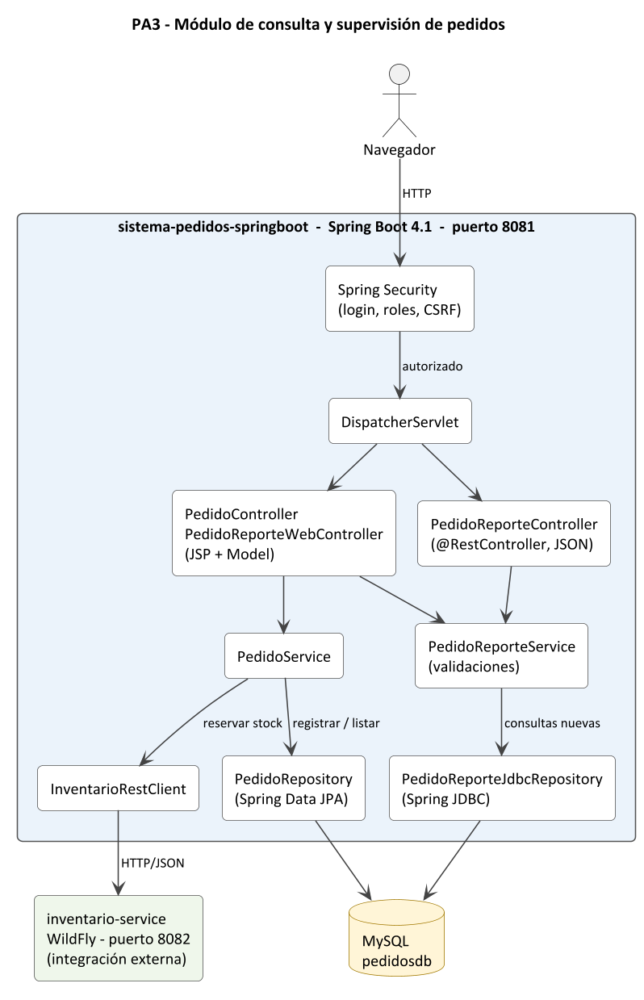

# PA3 — Desarrollo de Aplicaciones Empresariales Avanzado (ISIL, NRC 4622)

Módulo de consulta y supervisión de pedidos con Spring MVC, Spring Security y Spring JDBC.

| Proyecto | Tecnología | Puerto | Base de datos |
|---|---|---|---|
| [`sistema-pedidos-springboot`](sistema-pedidos-springboot/README.md) | Spring Boot 4.1 (aquí está el desarrollo de la PA3) | 8081 | MySQL (H2 solo en pruebas) |
| [`inventario-service`](inventario-service/README.md) | Jakarta EE 11 · WildFly 41 (dependencia externa, sin cambios) | 8082 | SQL Server |

Rama evaluada: `feature/pa3-perez`. Las capturas están en `evidencias/` y los scripts para reproducirlas en `scripts/demo-pa3/`.
